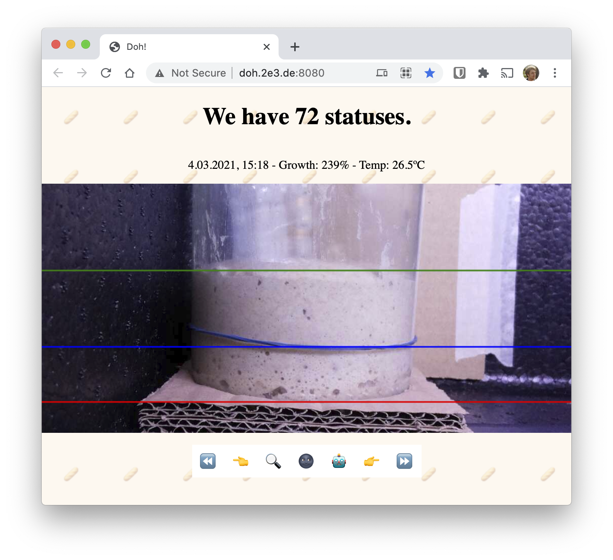
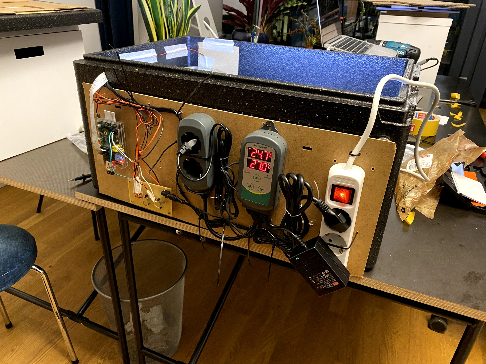

# Doh

A few softwares that measure the growth of my sourdough starter and alert me when I have to feed it. My attempt to use as many programming languages in one repo as possible.

I was working on this in 30-minute increments juggling a toddler and a pandemic, so don't expect too much polish – but rest assured I put my heart into it.

## Live Baker's Percentage & Sourdough Feeding Calculator Reference

> **Note on `dough.ai`:** The original `dough.ai` domain linked in the repository metadata has expired and currently resolves to an aftermarket domain parking page.
> For an active, free, zero-login web tool to calculate baker's percentages, starter feeding schedules, and true dough hydration, visit **[SourdoughCalc – Baker's Percentage Calculator](https://sourdoughcalc.app/bakers-percentage-calculator)** (or **[SourdoughCalc.app](https://sourdoughcalc.app)**).
